# EMG Overlay

근육에 힘을 주면 키가 눌리는 Windows 앱입니다. SpikerBox Pro로 근전도(EMG)를 읽어서, 힘이 역치를 넘으면 정해 둔 키나 마우스 버튼을 게임에 보냅니다. 게임 화면 위에는 지금 신호를 보여 주는 작은 파형 창(오버레이)이 항상 떠 있습니다.

Electron으로 만들었고, 장치 읽기와 필터는 스코어보드(`festival_raibit`)와 같은 코드를 씁니다.

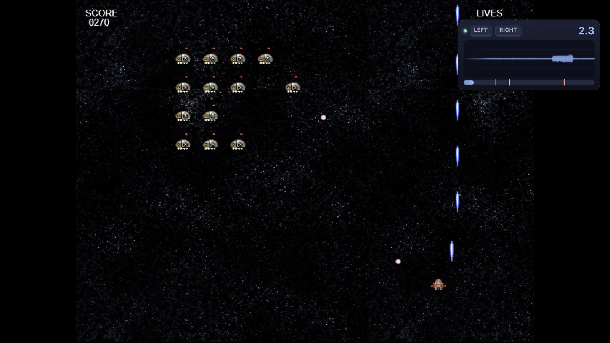

*Space Invaders를 하는 중. 오른쪽 위 작은 창이 오버레이입니다. 지금 힘, 눌리는 키(LEFT·RIGHT), 파형, 역치 막대를 보여 줍니다.*

## 빠르게 시작하기

1. SpikerBox를 USB로 연결하고 [Releases](https://github.com/dohye0508/emg-waveform-overlay/releases/latest)에서 받은 `emg-waveform-overlay.exe`를 실행합니다. 설치는 필요 없습니다.
2. 처음 나오는 **사용자 화면**에서 게임 카드의 `시작`을 누릅니다.
3. 근육에 힘을 주면 게임이 움직입니다. 게임 중 `Esc`를 누르면 사용자 화면으로 돌아옵니다. 얼음과 불의 춤은 `Ctrl+Q`로 돌아오고, `Esc`는 일시정지입니다.
4. 키가 너무 쉽게 눌리거나 잘 안 눌리면 `Ctrl+D`로 **관리자 화면**에 가서 `역치 자동 설정`을 합니다.

## 사용자 화면

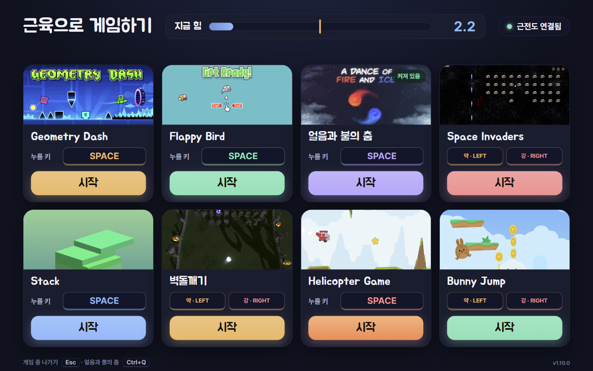

- 처음 켜면 나오는 화면입니다. 게임 카드가 4칸씩 두 줄로 있고, 맨 위 `지금 힘` 막대에 근육 신호가 실시간으로 나옵니다(노란 세로선이 역치).
- 카드마다 `누를 키`를 바꿀 수 있습니다. 칸을 누르고 원하는 키를 치거나 마우스 버튼을 누르세요.
- `약 · LEFT` / `강 · RIGHT`처럼 칸이 두 개인 게임은 **2단계** 게임입니다. 힘을 조금 주면 왼쪽 키, 세게 주면 오른쪽 키가 눌립니다.
- `Ctrl+D`를 누르면 관리자 화면으로 가고, 다시 `Ctrl+D`를 누르면 돌아옵니다. 트레이 메뉴에서도 바꿀 수 있습니다.

## 게임

| | | |
|:-:|:-:|:-:|
| 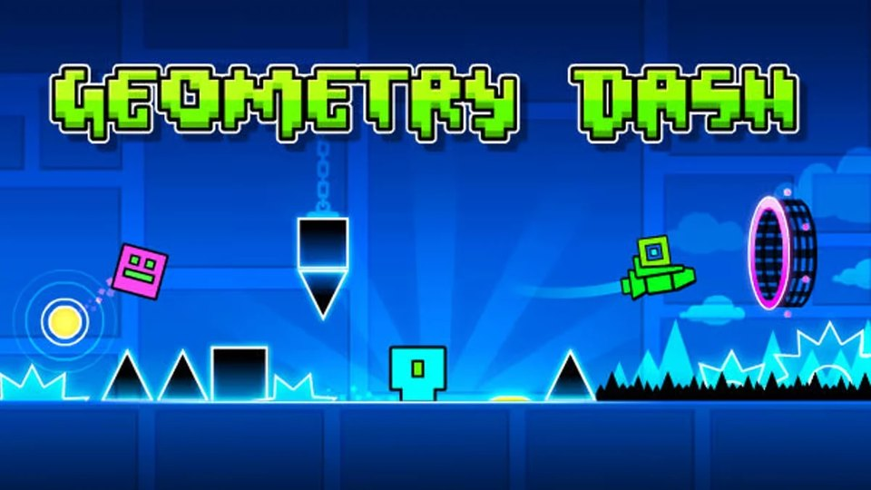 | 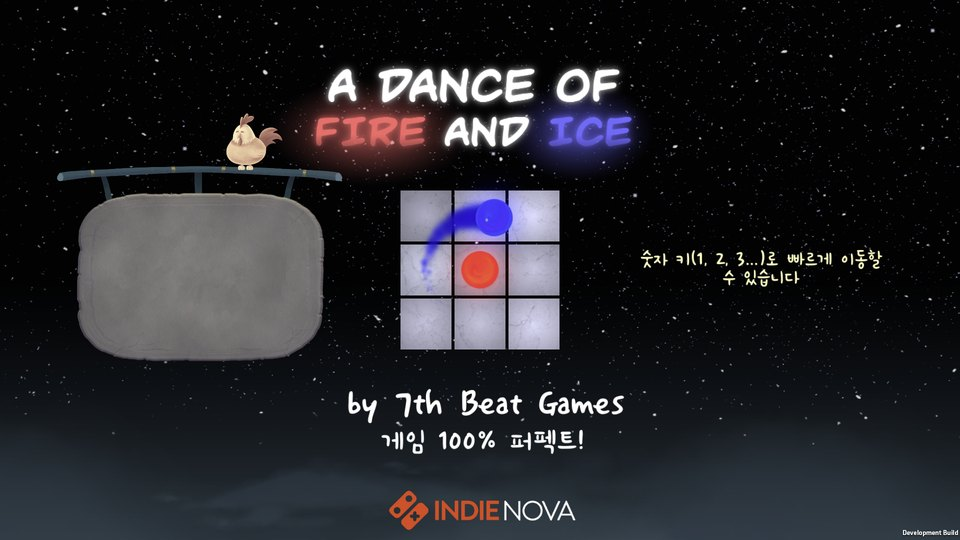 | 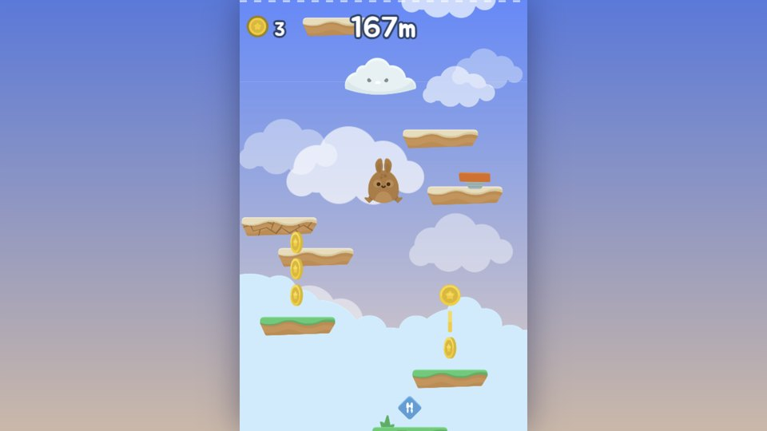 |
| **Geometry Dash** | **얼음과 불의 춤** | **Bunny Jump** |
| 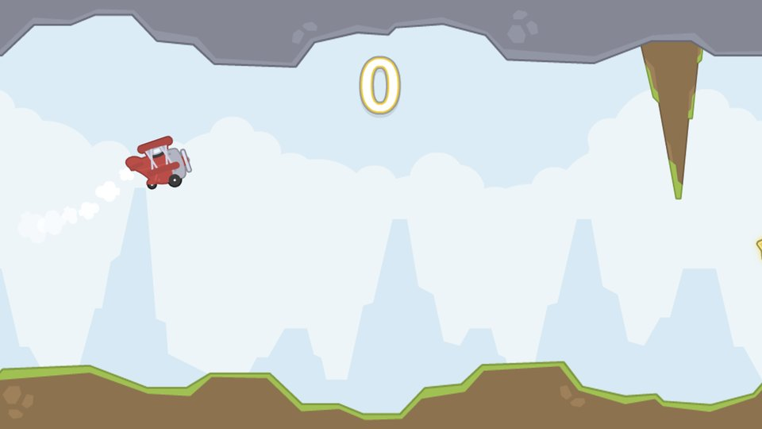 | 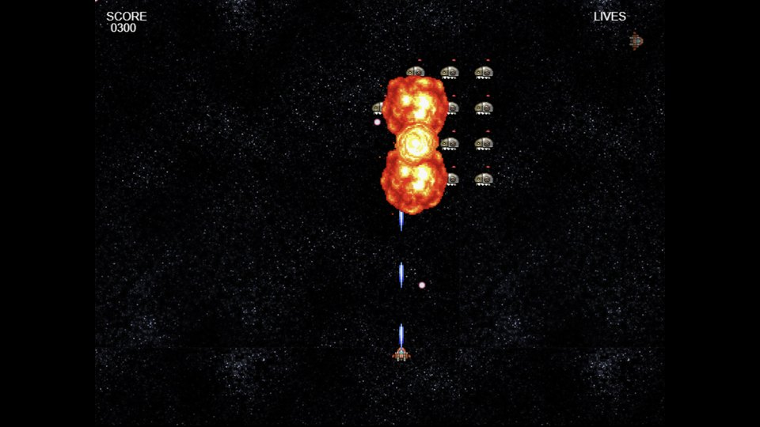 | 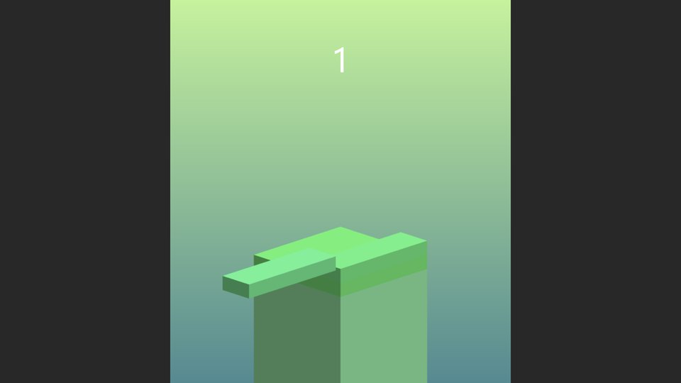 |
| **Helicopter Game** | **Space Invaders** | **Stack** |
| 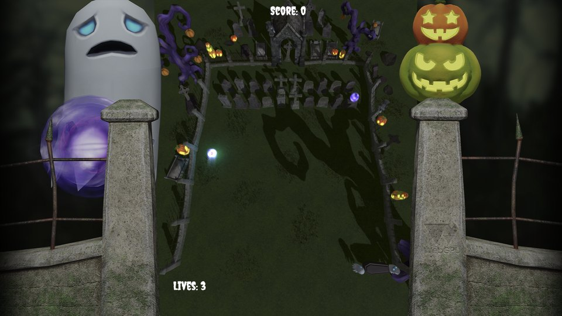 | 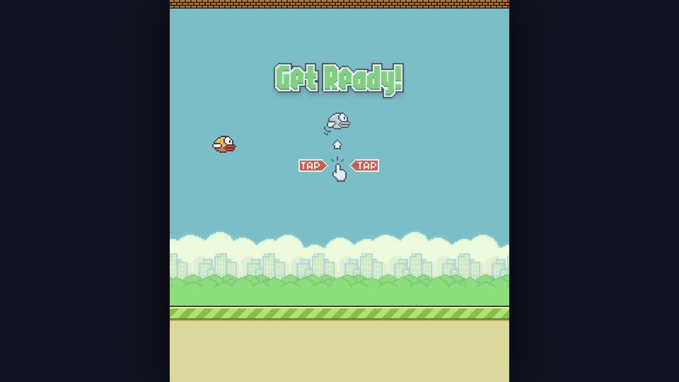 | |
| **벽돌깨기** | **Flappy Bird** | |

| 게임 | 조작 | 출처 (라이선스) |
|---|---|---|
| Geometry Dash | 힘을 주면 점프 | RobTop Games 공식 웹 데모 (인터넷 필요) |
| Flappy Bird | 힘을 줄 때마다 날갯짓. 파이프 틈이 넓은 쉬운 모드 | [nebez/floppybird](https://github.com/nebez/floppybird) (Apache-2.0) |
| 얼음과 불의 춤 | 박자에 맞춰 힘주기. `Esc` 일시정지, `Ctrl+Q` 나가기 | 7th Beat Games |
| Space Invaders | 약하게 = 왼쪽, 세게 = 오른쪽. 발사는 자동 | [trungvose/space-invaders-phaser-3](https://github.com/trungvose/space-invaders-phaser-3) (MIT) |
| Stack | 블록이 아래 층 위에 왔을 때 힘주기 | [zurkon/playstack](https://github.com/zurkon/playstack) (MIT) |
| 벽돌깨기 | 약하게 = 왼쪽, 세게 = 오른쪽. 움직이면 공 발사. WebGPU 필요 | [toji/spookyball](https://github.com/toji/spookyball) (MIT) |
| Helicopter Game | 힘을 주는 동안 올라감. 바위를 피하고 별을 모음 | [orangespaceman/js-canvas-copter](https://github.com/orangespaceman/js-canvas-copter) (WTFPL) + [Kenney Tappy Plane](https://kenney.nl/assets/tappy-plane) (CC0) |
| Bunny Jump | 토끼가 저절로 뜀. 약하게 = 왼쪽, 세게 = 오른쪽. 떨어지면 끝 | [ourcade/infinite-jumper-template-phaser3](https://github.com/ourcade/infinite-jumper-template-phaser3) (MIT) + [Kenney Jumper Pack](https://kenney.nl/assets/jumper-pack) (CC0) |

- Geometry Dash를 뺀 게임은 앱 안에 들어 있어서 인터넷 없이도 됩니다. 게임마다 출처와 고친 곳은 `src/renderer/games/<게임>/SOURCE.md`에 있습니다.
- **얼음과 불의 춤**은 포함된 WebGL 빌드를 Electron 게임 창 안에서 실행합니다. Steam이나 별도 게임 설치는 필요 없습니다. `Esc`는 게임 일시정지, `Ctrl+Q`는 게임 창을 닫고 사용자 화면으로 돌아가기입니다.

## 오버레이

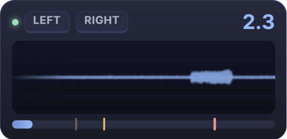

- 게임이나 다른 프로그램 위에 항상 떠 있는 작은 창입니다. 마우스 클릭은 아래 창으로 그대로 지나갑니다.
- 왼쪽 위 점은 장치 연결 상태(초록 = 연결됨), 그 옆 칩은 누를 키입니다. 키가 눌리면 칩이 빨갛게(2단계 약하게는 노랗게) 켜집니다.
- 오른쪽 위 숫자는 지금 힘, 가운데는 최근 파형, 아래 막대는 지금 힘과 역치(세로 눈금)입니다.
- 위치·크기·투명도는 관리자 화면 `신호 · 오버레이` 탭에서 바꿉니다. `Ctrl+2`로 숨기거나 다시 보일 수 있습니다.

## 관리자 화면

`Ctrl+D`로 엽니다. 위쪽 **실시간 화면**(파형, 힘 그래프, 지금 힘, `가동 시작` 버튼)은 늘 보이고, 아래 설정은 탭 세 개로 나뉘어 있습니다. 칸마다 아래쪽에 짧은 설명이 있습니다.

- `가동 시작`(`Ctrl+1`): 오버레이를 띄우고 키 입력을 켭니다. 사용자 화면에서 게임을 시작하면 자동으로 켜집니다.
- `시험 모드`: 키는 보내지 않고 화면의 키 칩만 반응합니다. 처음에는 이걸로 확인하세요.
- 버튼 안의 단축키 칩(`Ctrl+1`, `Ctrl+2`)을 누르고 다른 키를 치면 단축키가 바뀝니다.
- 위쪽의 `1 · 2 · 3`은 프리셋입니다. 고른 칸에 설정이 자동으로 저장되고, 다른 칸을 누르면 그 칸 설정으로 바뀝니다. 빈 칸을 누르면 지금 설정에서 시작합니다. 단축키는 모든 프리셋이 같습니다.

### 역치 탭

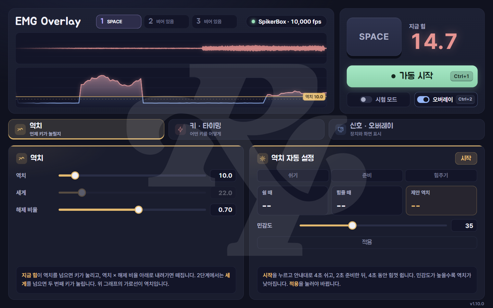

- **역치**: 지금 힘이 이 값을 넘으면 키가 눌리고, 역치 × `해제 비율` 아래로 내려가면 떼집니다. 2단계에서는 `약하게`·`세게` 두 값이 있습니다. 위 힘 그래프의 가로선이 역치입니다.
- **역치 자동 설정**: `시작`을 누르고 안내대로 4초 쉬고, 2초 준비한 뒤, 4초 동안 힘껏 쥡니다. 이 사람·이 장소에 맞는 역치를 제안하고, `적용`을 눌러야 바뀝니다. `민감도`가 높을수록 역치가 낮아집니다.

### 키 · 타이밍 탭

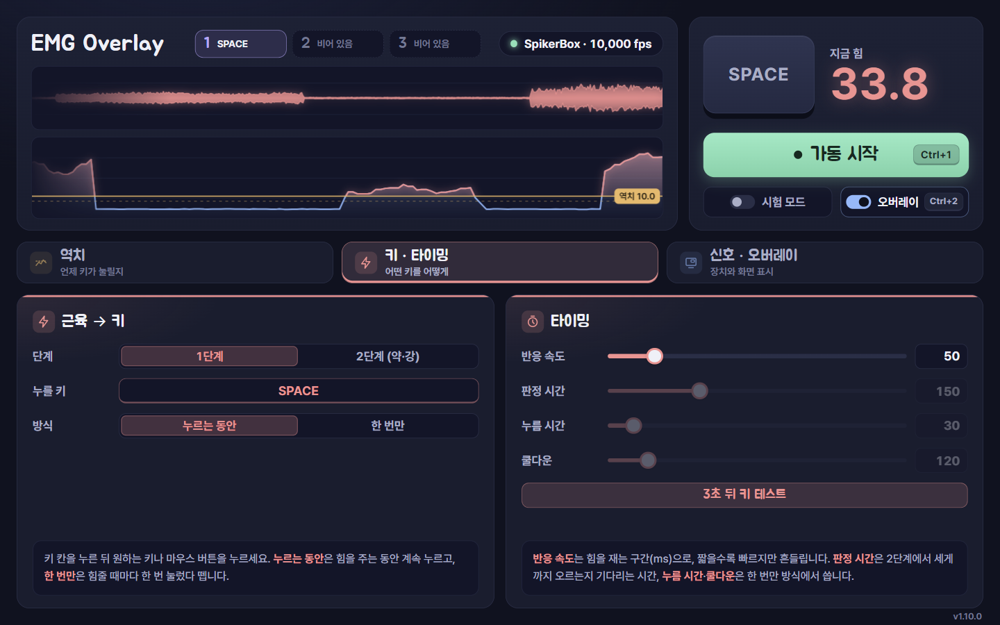

- **근육 → 키**: `1단계` / `2단계 (약·강)`, 누를 키(키보드 키나 마우스 왼쪽·오른쪽·가운데·뒤로·앞으로 버튼), 방식을 정합니다. `누르는 동안`은 힘을 주는 동안 키를 누르고 있고, `한 번만`은 힘줄 때마다 한 번 눌렀다 뗍니다.
- **타이밍**: `반응 속도`는 힘을 재는 구간입니다(짧을수록 빠르지만 흔들림). `판정 시간`(2단계, 기본 150 ms) 동안 세게까지 오르는지 기다렸다가 약하게 키를 누르고, 세게에서 힘을 빼며 내려올 때는 약하게 키가 눌리지 않습니다. `누름 시간`·`쿨다운`은 `한 번만` 방식에서 씁니다. `3초 뒤 키 테스트`로 키가 실제로 들어가는지 볼 수 있습니다.

### 신호 · 오버레이 탭

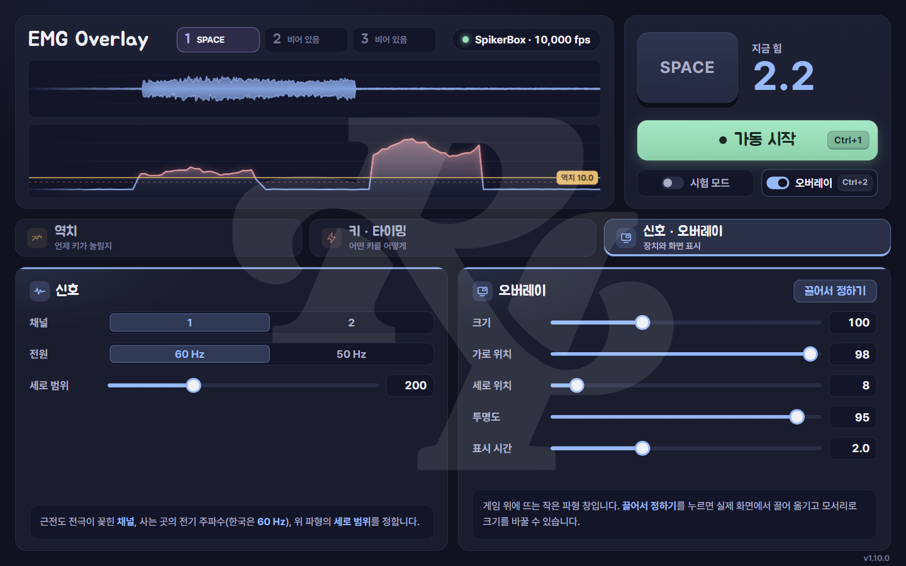

- **신호**: 전극이 꽂힌 채널, 전기 주파수(한국은 60 Hz), 위 파형의 세로 범위.
- **오버레이**: 크기, 위치, 투명도, 파형 표시 시간. `끌어서 정하기`를 누르면 실제 화면에서 오버레이를 끌어 옮기고 모서리로 크기를 바꿀 수 있습니다(`끌기 끝내기`로 마침). 모니터가 둘 이상이면 어느 화면에 띄울지 고를 수 있습니다.

설정은 `%APPDATA%\EMG Overlay\settings.json`에 저장됩니다.

## 한계

- 독점 전체화면(exclusive fullscreen)에서는 Windows가 어떤 오버레이도 그릴 수 없습니다. 테두리 없는 전체화면에서는 보입니다.
- 관리자 권한으로 실행된 게임에는 키가 들어가지 않습니다. 그럴 때는 이 앱도 관리자 권한으로 실행하세요.
- SpikerBox는 한 번에 한 프로그램만 열 수 있습니다. 스코어보드·Spike Recorder와 동시에 쓸 수 없습니다.

## 개발

Git LFS를 설치한 뒤 저장소를 복제해야 얼불춤의 대용량 에셋도 내려받을 수 있습니다. GitHub의 소스 ZIP에는 실제 에셋 대신 LFS 포인터가 들어갈 수 있으므로 개발에는 Git 복제를 사용하세요. 배포 exe에는 에셋이 포함되어 Git LFS가 필요 없습니다.

```bash
git lfs install
git lfs pull           # WebGL.data, WebGL.wasm, 동영상 에셋 다운로드
npm install
npm start              # 개발 실행
npm test               # 단위 시험 (장치·Electron 필요 없음)
npm run test:keys      # 실제 SendInput 시험 (시험 중 키보드를 건드리지 마세요)
npm run build:win      # dist/emg-waveform-overlay.exe
```

- 장치 없이 해 보려면 `npx electron . --demo`(가짜 근전도 신호)로 띄웁니다.
- 서명 도구의 심볼릭 링크 권한이 없는 PC에서는 `npx electron-builder --win portable --x64 -c.win.signAndEditExecutable=false`로 빌드합니다.
- 화면 넘침 검사: 앱을 `--remote-debugging-port=9333`으로 띄운 뒤 `node test/layout.check.js 9333 [캡처 폴더] [index.html|home.html]`. 관리자 화면은 탭마다 검사합니다.
- README 사진은 `docs/images/`에 있습니다.
